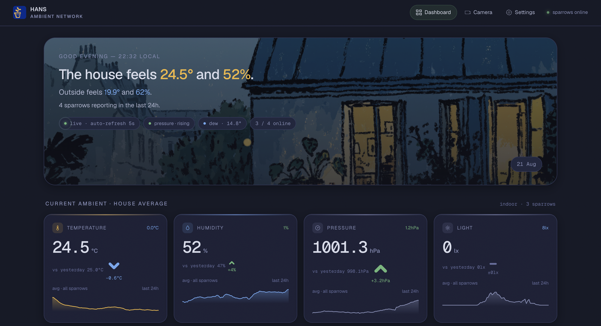
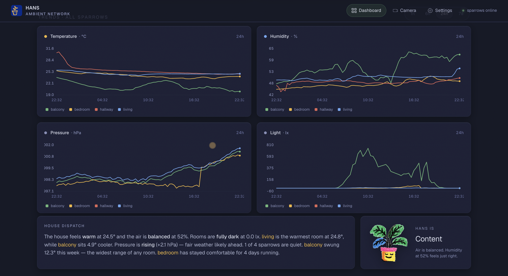
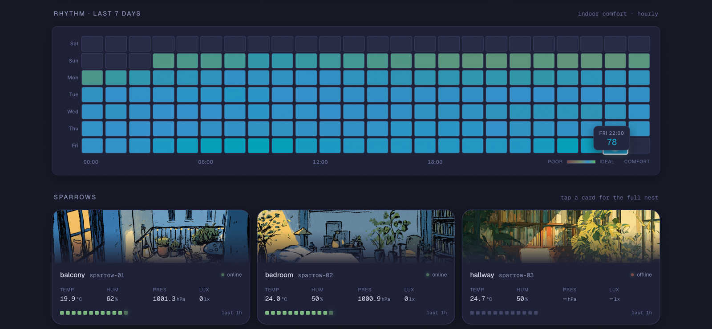
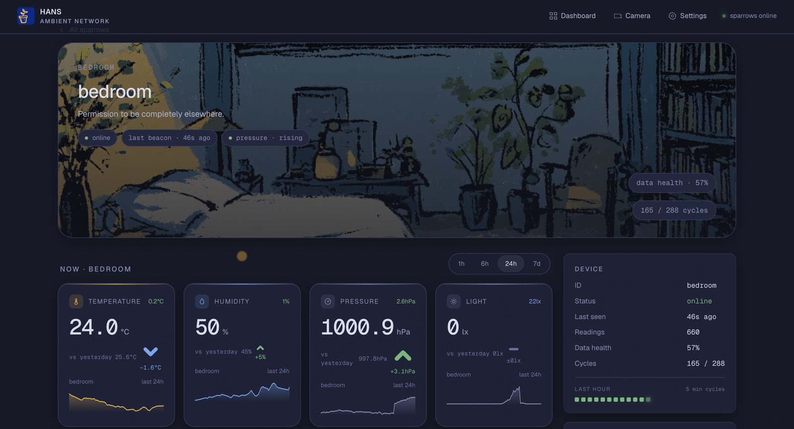
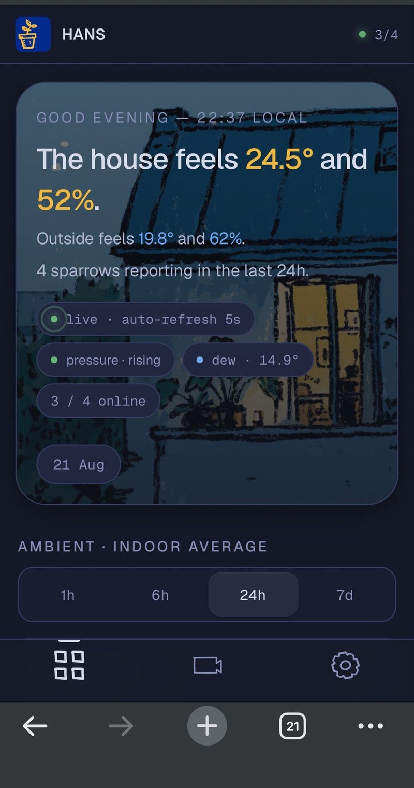
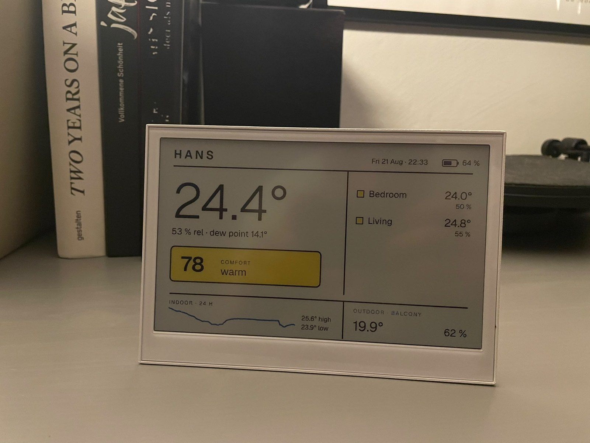

# Hans

A home climate monitor I built for my own flat: a handful of ESP8266 sensors report
temperature, humidity, pressure and light into Supabase, a Nuxt app turns that into a
dashboard, and a battery-powered e-paper panel on the wall shows the current state
without anyone having to open a phone.



## A look around

The house reads as one number first, then breaks down per room. Trends run over the
last 24 hours, and a plain-language dispatch says what actually changed.



A seven-day rhythm view shows when the flat is comfortable and when it is not, hour by
hour, with each sensor reporting in below it.



Each room gets its own page with device health and per-metric history.



The same dashboard on a phone, and the e-paper panel that shows it without one:

| Mobile | E-paper panel |
|---|---|
|  |  |

<!-- Demo video: upload the 30 s screen recording as a GitHub attachment and paste the
     resulting https://github.com/user-attachments/assets/... URL on its own line here. -->

## Why I built it

I wanted to know whether rooms were actually as stuffy as they felt, and existing
smart-home dashboards were either cloud-locked, ugly, or both. Building it myself also
meant one project that spans the whole stack — soldering sensors, an HTTPS POST from a
microcontroller, row-level security in Postgres, a Vue frontend, and server-side image
rendering for a display that cannot run JavaScript.

The e-paper panel is the part I like most. It has no renderer of its own: it wakes on a
timer, fetches a finished 800×480 PNG from `/api/epaper.png`, paints it, and sleeps
again. All layout and dithering happen on the server, so a design change ships by
redeploying the app rather than reflashing hardware.

## How it fits together

```
Sparrow sensors                Supabase                 Nuxt app
ESP8266 + BME280/BH1750  ──▶   Postgres + RLS   ──▶     dashboard (browser)
HTTPS POST every 5 min         sensor_readings          /api/epaper.png ──▶ e-paper panel
                                                                            ESPHome, deep sleep
```

## Tech stack

| Layer | What |
|---|---|
| Frontend | Nuxt 4, Vue 3, Nuxt UI, Chart.js |
| Backend | Nitro server routes, Supabase (Postgres, Auth, RLS) |
| E-paper rendering | Server-side SVG → PNG via `@resvg/resvg-js` + `pngjs`, dithered to the panel palette |
| Sensor firmware | C++ / Arduino on ESP8266, BME280 (temp/humidity/pressure) + BH1750 (lux) |
| Display firmware | ESPHome on a Seeed reTerminal E1002 |
| Hosting | Vercel |

## Setup

You need Node 20+, a Supabase project, and (optionally) the hardware.

1. **Install and configure**

   ```bash
   npm install
   cp .env.example .env
   ```

2. **Fill in `.env`** — `SUPABASE_URL` and `SUPABASE_KEY` from your project's API
   settings. `SUPABASE_SERVICE_ROLE_KEY` is only needed for the e-paper endpoint, which
   reads without a user session. `EPAPER_TOKEN` is any long random string.

3. **Create the schema** — a `devices` table and a `sensor_readings` table
   (`sparrow_id`, `metric`, `value`, `recorded_at`), with RLS enabled: insert-only for
   the anon role, reads restricted to authenticated users.
   Optionally a `birdhouse_visits` table (`day` date, `visits` int, `recorded_at`
   timestamptz default now()), same RLS. The birdhouse camera Pi appends a row whenever a
   day's count changes; the panel header shows today's count, before 09:00 yesterday's,
   followed by the total of the last seven days, that one included.

4. **Run it**

   ```bash
   npm run dev
   ```

   Sign in at `/login` with a Supabase user. Without sensors the dashboard renders
   empty; `/api/epaper.png` works as soon as there is one reading.

5. **Hardware (optional)** — flashing instructions for the panel are in
   [firmware/hans_display/README.md](firmware/hans_display/README.md). For a sensor, copy
   `firmware/sparrow_sensor/secrets.example.h` to `secrets.h` in the same folder, fill in
   your Wi-Fi credentials, your Supabase URL and anon key, and a `SPARROW_ID` that exists
   in the `devices` table. Both `secrets.h` and the panel's `secrets.yaml` are git-ignored.

## Current state

This is a personal project that runs in my flat, not a product. Being honest about where
it stands:

- **Working:** sensor ingestion, the dashboard (live metrics, charts, heatmap, comfort
  scoring), JSON data export, and the full e-paper pipeline including battery reporting
  and deep sleep.
- **Single-user by design.** Auth is Supabase email/password against one account. There
  is no multi-tenancy, no onboarding, and no device-provisioning UI — sensors are added
  by inserting a row by hand.
- **Stubs:** the camera page is a placeholder for a feed that was never wired up, and
  `server/api/readings.get.ts` is a leftover that returns an empty array. The client
  queries Supabase directly instead.
- **No tests.** There is no test suite and no CI.
- **Not hardened for public deployment.** The e-paper endpoint is protected by a shared
  token over the home LAN, which is proportionate to the threat model of my living room
  and nothing more.

## License

[MIT](LICENSE).

The illustrations in `public/sparrows/` and `public/hans/` are AI-generated and are not
covered by the MIT license above.
